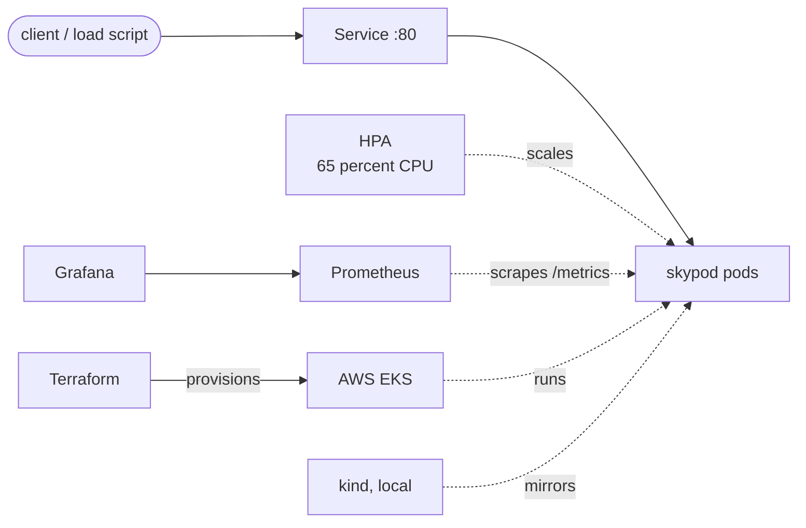

<div align="center">

# skypod

**A small Go service, and the cloud platform that runs it.**


One repo, two halves: an application worth deploying, and everything
needed to deploy it properly, locally on kind or on AWS EKS.

</div>

## What this is

The app is a tiny Go HTTP service on purpose. It answers, it burns CPU on
request (`/work?ms=300`) so autoscaling has something real to react to,
it exposes its own Prometheus metrics, and it ships as a small static
binary in a scratch image, with no shell and no userland to speak of.
The interesting part is the platform around it:

- a **Helm chart** with probes, a hardened security context, an HPA and a
  PodDisruptionBudget
- **Terraform** that builds the AWS side from nothing: VPC, subnets,
  NAT, IAM, an EKS cluster and a node group in private subnets
- **Prometheus and Grafana** wiring: a ServiceMonitor for the app, a
  dashboard for its metrics, and two alerts
- **CI** that vets and tests the Go code, lints and renders the chart,
  checks and validates the Terraform, and builds the image, plus a
  **release workflow** that publishes to GHCR



## Quickstart: run it locally

You need Docker, plus `kubectl`, `helm` and `kind` (versions print with
`make tools`). Then:

```
make demo
kubectl -n skypod port-forward svc/skypod 8080:80
curl localhost:8080/
```

`make demo` creates a three node kind cluster, builds the image, loads
it in, and installs the chart with autoscaling on. Now give the HPA
something to do:

```
make load
kubectl -n skypod get hpa -w
```

The load script hammers `/work?ms=200` from a dozen workers for two
minutes. CPU climbs past the 65 percent target and the replica count
follows it up, then settles back down when the load stops.

## The AWS path

```
cd terraform
terraform init
terraform plan
terraform apply
```

This creates the EKS cluster described in `terraform/README.md`,
including the cost notes. Connect and install the chart:

```
aws eks update-kubeconfig --name skypod --region ap-south-1
helm upgrade --install skypod charts/skypod --namespace skypod --create-namespace
```

Destroy with `terraform destroy` when you are done looking at it.

## What is inside

| Directory | Contents |
| --- | --- |
| `app/` | The Go service, its tests, and a multi-stage Dockerfile |
| `charts/skypod/` | The Helm chart: Deployment, Service, HPA, PDB, ServiceMonitor and an optional Ingress |
| `terraform/` | VPC, EKS cluster, managed node group, IAM. Plain resources, no external modules |
| `deploy/local/` | The kind cluster definition used by the Makefile |
| `deploy/monitoring/` | kube-prometheus-stack values, a Grafana dashboard, two PrometheusRule alerts |
| `deploy/argocd/` | An optional ArgoCD Application that syncs this repo onto a cluster |
| `.github/workflows/` | CI on every push, and the release publisher |

The app itself:

| Route | What it does |
| --- | --- |
| `GET /` | JSON with service name, version and pod hostname |
| `GET /healthz`, `GET /readyz` | Plain 200 ok, used as the probes |
| `GET /metrics` | Prometheus text, hand-written, no client library |
| `GET /work?ms=N` | Burns about N ms of CPU (capped at 2000) |
| `GET /echo` | Reflects method, path and headers back as JSON |

## Observability

`make monitoring` installs kube-prometheus-stack into its own namespace.
The chart's ServiceMonitor points Prometheus at the app's `/metrics`, the
dashboard in `deploy/monitoring/dashboards/` covers request rate, error
rate, latency, pod CPU and HPA replicas, and `alerts.yaml` adds rules for
a high error rate and for pods restarting too often.

## CI and releases

Every push runs four checks: Go vet and tests, Helm lint and template,
Terraform format and validate, and a Docker build. Tagging a version
(`git tag v0.1.0`) triggers the release workflow, which pushes
`ghcr.io/sachujames/skypod` and attaches the packaged Helm chart to the
GitHub release.

## Honest limits

The Terraform is checked with `fmt` and `validate` in CI and locally, and
the chart is linted, rendered and schema-checked, but the EKS stack in
this repo has not been applied to a live AWS account yet. The kind
quickstart was written and verified at the template level in an
environment without a Docker daemon, so the full load test loop is
documented from the mechanism (HPA at 65 percent of the CPU request,
`/work` burning real CPU) rather than from a run I can show you numbers
for. If you run `make demo` on a machine with Docker, that is the demo.

The service is stateless and tiny by design. The point of the repo is
the platform, and the platform makes no claim to be finished either:
ingress is off by default, there is no TLS story, and the Terraform uses
one NAT gateway where a serious setup would run one per AZ.

## License

MIT. See [LICENSE](LICENSE).
